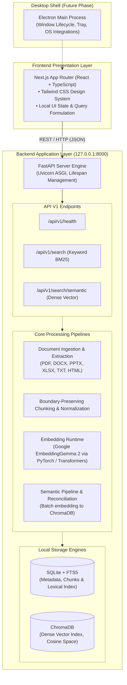
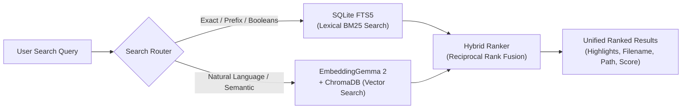
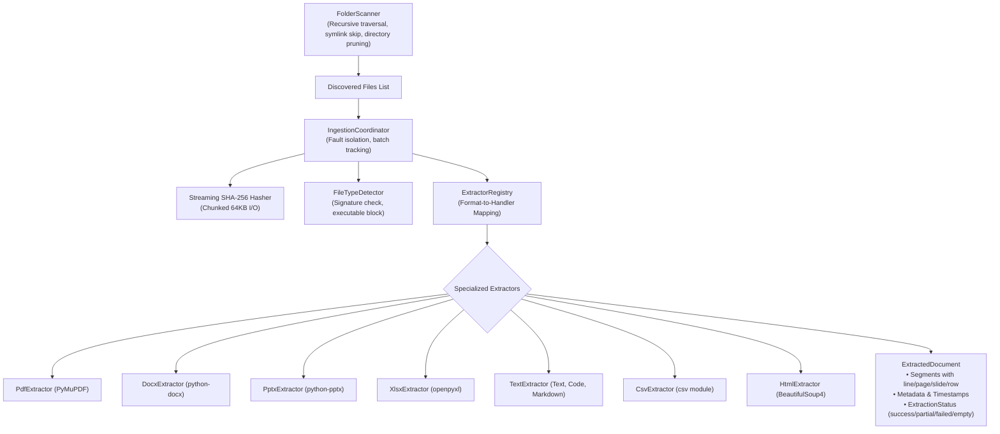
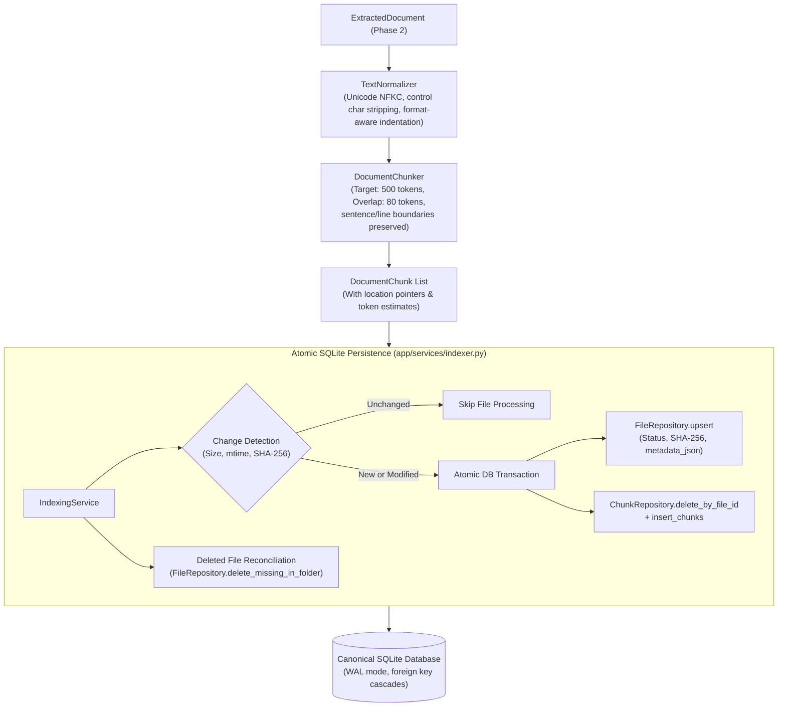
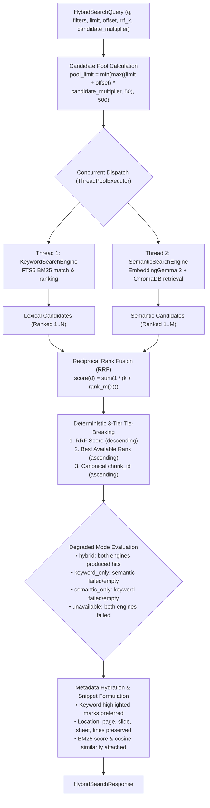
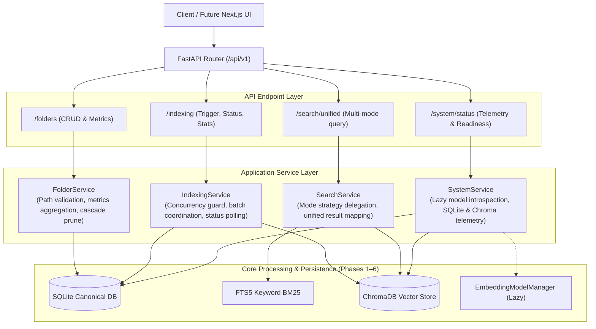

# OmniSearch Architecture Document

## 1. System Overview

**OmniSearch** is an AI-powered, local-first multifile search and personal knowledge discovery desktop application for Windows. The system is designed to index and query heterogeneous local files—including documents, presentations, spreadsheets, and notes—without transmitting user data to external cloud services.



---

## 2. Component Responsibilities

### 2.1 Frontend (`/frontend`)
- **Framework:** Next.js (React 19, TypeScript, App Router).
- **Styling:** Tailwind CSS with a restrained dark navy theme (`#070B14`, `#0B1120`) and subtle cyan accents (`#06B6D4`, `#22D3EE`).
- **Role:** Pure presentation and user interaction layer. Manages query inputs, preview rendering, search result navigation, and client-side configuration.
- **Constraints:**
  - Zero direct file system mutation or heavy binary parsing on the UI thread.
  - Communicates with the backend strictly over HTTP (`http://127.0.0.1:8000`).

### 2.2 Backend (`/backend`)
- **Framework:** Python 3, FastAPI, Pydantic, Pydantic Settings, Uvicorn.
- **Role:** Local application core handling system health, configuration management, logging, file ingestion, search orchestration, and index storage.
- **Network Scope:** Binds exclusively to the loopback interface (`127.0.0.1`). It does not bind to `0.0.0.0` to prevent accidental network exposure on local area networks.
- **Modular Directory Breakdown:**
  - `app/api/`: Versioned route definitions and endpoint controllers.
  - `app/core/`: Centralized Pydantic Settings and structured logging.
  - `app/models/`: Internal domain entities and database models.
  - `app/schemas/`: Strict Pydantic input/output schemas for API validation.
  - `app/services/`: Pure business logic (e.g., search ranking, document parsing).
  - `app/utils/`: Generic, decoupled utility functions.

### 2.3 Desktop Integration (Future Phase)
- **Framework:** Electron.
- **Role:** Native Windows window frame, background process lifecycle management, system tray integration, and native file manager actions (e.g., "Reveal in File Explorer").
- **Integration Boundary:** Launches and monitors the local Uvicorn process and hosts the bundled Next.js client interface.

---

## 3. Storage and Search Architecture (Planned Roadmap)

OmniSearch avoids cloud dependency by utilizing two complementary, local storage backends:



1. **SQLite + FTS5 (Lexical Search):**
   - Stores file metadata (paths, timestamps, file sizes, MIME types, content hashes).
   - Full-Text Search 5 (FTS5) index for exact term matches, wildcards, and keyword queries.
   - Operates entirely offline with negligible RAM footprint.

2. **ChromaDB + Google EmbeddingGemma 2 (Semantic Search):**
   - High-efficiency local vector embeddings generated by Google EmbeddingGemma 2.
   - ChromaDB stores dense document chunk vectors locally.
   - Enables conceptual and natural-language retrieval even when the user forgets exact phrasing.

3. **Hybrid Search Fusion:**
   - Results from SQLite FTS5 (lexical) and ChromaDB (vector) are fused using Reciprocal Rank Fusion (RRF) to provide balanced, highly accurate search rankings.

---

## 4. Multi-Format Ingestion & Extraction Engine (Phase 2 Implemented)

The document ingestion subsystem is implemented inside `backend/app/ingestion/` as a decoupled, fault-isolated pipeline:



### 4.1 Ingestion Components
1. **`FolderScanner` (`app/ingestion/scanner.py`):**
   - Traversing local paths recursively with in-place directory exclusion (`.git`, `node_modules`, `.venv`, `__pycache__`, etc.).
   - Follows no symbolic links by default to prevent traversal loops.
   - Categorizes findings into supported, unsupported, and skipped files.
2. **`FileTypeDetector` (`app/ingestion/file_detector.py`):**
   - Validates file headers without loading entire files into memory.
   - Blocks disguised executables (`MZ`, `ELF`, Mach-O) regardless of file extension.
   - Validates format headers (e.g. `%PDF-`, Zip headers for DOCX/PPTX/XLSX).
3. **`Streaming Hasher` (`app/ingestion/hashing.py`):**
   - Computes deterministic SHA-256 digests in 64 KB streaming blocks.
4. **`ExtractorRegistry` (`app/ingestion/registry.py`):**
   - Manages registered extractors and maps extensions to their respective handlers.
5. **`IngestionCoordinator` (`app/ingestion/coordinator.py`):**
   - Orchestrates extraction across single files or batches.
   - Enforces complete error isolation: an individual file failure (e.g. corrupt PDF or unreadable DOCX) never aborts the batch.

---

## 5. Content Processing & Persistent Indexing (Phase 3 Implemented)

The content processing and persistence layer transforms extracted documents into normalized, semantic chunks stored persistently in SQLite:



### 5.1 Content Processing Components
1. **`TextNormalizer` (`app/processing/normalizer.py`):**
   - Applies Unicode NFKC decomposition to normalize ligatures and compatibility characters.
   - Normalizes carriage returns (`\r\n` and `\r` to `\n`) and strips non-printable control characters.
   - Code-aware: strictly preserves leading indentation (spaces and tabs) for source code files.
   - Table-aware: preserves column separators and row boundaries without flattening data.
2. **`DocumentChunker` (`app/processing/chunker.py`):**
   - Divides documents into chunks targeting 450–600 tokens (default: 500) with ~80 token overlap.
   - Preserves sentence boundaries in prose and line boundaries in code without breaking statements.
   - Preserves source-location metadata (`page_number`, `slide_number`, `sheet_name`, `row_number`, `start_line`, `end_line`).
   - Short documents fitting within target token size remain single intact chunks.
3. **`Token Counter` (`app/processing/token_counter.py`):**
   - Pluggable `BaseTokenCounter` interface.
   - `ApproximateTokenCounter` provides deterministic subword token approximations for BPE-like models prior to EmbeddingGemma integration in Phase 5.
4. **`SQLite Database Architecture` (`app/database/`):**
   - Uses Python's standard-library `sqlite3` with `check_same_thread=False` and connection pooling.
   - Enforces WAL journal mode (`PRAGMA journal_mode = WAL;`) and synchronous normal for high desktop throughput.
   - Enforces relational foreign keys (`PRAGMA foreign_keys = ON;`) with cascade deletions.
   - Versioned migrations tracked in `schema_migrations`.
   - Startup recovery policy (`recover_interrupted_jobs`) cleans up any jobs left running after an abnormal process exit.
5. **`IndexingService` (`app/services/indexer.py`):**
   - Orchestrates folder scanning, file change detection, ingestion, chunking, and database storage.
   - Atomic chunk replacement: old chunks are safely purged and replaced inside an atomic transaction.
   - Reconciliation: deletes records for files removed from disk.

---

## 6. Keyword Search Engine (Phase 4 Implemented)

The keyword search subsystem is implemented inside `backend/app/search/` as a modular, offline-capable search engine built upon SQLite FTS5:

```mermaid
flowchart TD
    RawQuery["Raw User Query\n(e.g., '\"neural networks\" python NOT java')"] --> QueryParser["QueryParser (app/search/query_parser.py)\n• Exact phrase preservation\n• Technical identifier preservation\n• Unclosed quote auto-balancing\n• Operator sanitization & syntax safety"]
    
    QueryParser --> FTSQuery["Safe FTS5 MATCH Expression"]
    
    subgraph EngineExecution["KeywordSearchEngine (app/search/keyword_search.py)"]
        FTSQuery --> FTSTable[("chunks_fts (SQLite FTS5)\ncontent (w=5.0), filename (w=2.0), doc_title (w=1.0)")]
        FTSTable --> BM25Rank["BM25 Scoring (SQLite bm25() function)\nAscending rank order"]
        BM25Rank --> Snippets["Snippet Generation (snippet() with markers)"]
        Snippets --> Windowing["Window Function Deduplication\n(ROW_NUMBER() OVER PARTITION BY file_id)\nLimits max_chunks_per_file"]
        Windowing --> Filtering["Metadata Filters\n(file_type, folder_id, folder_path)"]
        Filtering --> JoinCanonical["Join canonical chunks & files\n(Preserves structural location pointers)"]
    end
    
    JoinCanonical --> SnippetFormatter["SnippetFormatter (app/search/snippets.py)\n• XSS Protection (html.escape)\n• Standardized <mark> tags\n• Highlights extraction & fallback"]
    
    SnippetFormatter --> SearchResponse["SearchResponse\n• SearchResultItems with score, bm25_rank, is_stale\n• Location: page, slide, sheet, lines\n• Execution time ms"]
```

### 6.1 Keyword Search Components
1. **`QueryParser` (`app/search/query_parser.py`):**
   - Parses complex user queries into safe SQLite FTS5 MATCH expressions.
   - Extracts exact quoted phrases (`"phrase"`) without breaking whitespace.
   - Preserves technical identifiers (`test_case_1`, `k-means`, `v1.2.3`, `C:\Windows\System32`).
   - Handles prefix searches (`comput*` -> `"comput"*`).
   - Preserves valid boolean operators (`AND`, `OR`, `NOT`) while stripping stray operators at query edges.
   - Neutralizes unsafe characters (`:`, `^`, `*`, `(`, `)`) to guarantee zero SQLite syntax crashes.
   - Empty or whitespace queries are safely identified without executing invalid SQL.
2. **`SnippetFormatter` (`app/search/snippets.py`):**
   - Translates FTS delimiter markers into standardized `<mark>` tags for client rendering.
   - Protects against XSS attacks by running `html.escape()` on document text before markup injection.
   - Extracts deduplicated lists of highlighted matching terms.
   - Generates contextual fallback snippets from chunk content when FTS snippets are empty.
3. **`KeywordSearchEngine` (`app/search/keyword_search.py`):**
   - Combines FTS5 BM25 scoring with weights prioritizing chunk content (5.0), filename matches (2.0), and document title (1.0).
   - Prevents single-document result dominance using window functions (`ROW_NUMBER() OVER (PARTITION BY file_id)`) to enforce `max_chunks_per_file` (default: 3).
   - Supports filtering by file extensions/types, folder IDs, and root paths.
   - Supports pagination with `limit` and `offset`.
   - Incorporates the failed re-indexing policy: retained chunks from files that encountered subsequent re-indexing failures are clearly flagged with `is_stale = True`.
4. **`FTS Virtual Table & Synchronization` (`app/database/migrations.py` & `app/database/repositories/fts.py`):**
   - Dedicated `chunks_fts` virtual table using `fts5` and `unicode61` tokenizer.
   - Automatic SQLite triggers (`trg_chunks_ai`, `trg_chunks_ad`, `trg_files_ad`, `trg_files_au`) maintain total synchronization across chunk insertion, chunk replacement, file cascade deletion, and file updates.
   - `FtsRepository` provides manual rebuild (`rebuild_index`) and segment consolidation (`optimize`).

---

## 7. Semantic Search Engine (Phase 5 Implemented)

The semantic search subsystem delivers natural-language understanding using local vector embeddings:

1. **`EmbeddingGemma 2` Local Inference (`app/embeddings/`):**
   - Official task-specific prefixes: `"task: search document | query: "` for documents and `"task: search query | query: "` for queries.
   - Matryoshka dimension truncation with explicit L2 unit normalization.
   - Lazy singleton model loading via `EmbeddingModelManager` ensuring fast startup and clean CPU offload.
2. **`ChromaDB Vector Store` (`app/vector_store/chroma.py`):**
   - Persistent vector storage with cosine distance metric ($similarity = 1.0 - distance$).
   - Synchronous metadata filtering supporting `$and` conjunctions and `$in` lists for folder and file type scoping.
3. **`Semantic Pipeline & Reconciliation` (`app/services/semantic_pipeline.py`):**
   - Incremental batch chunk embedding with SQLite tracking table (`chunk_embeddings`).
   - Automated reconciliation cleaning orphaned vectors when documents are modified or removed.
4. **`SemanticSearchEngine` (`app/search/semantic_search.py`):**
   - Hydrates vector search candidate hits with canonical SQLite chunk metadata, file statuses, and location coordinates.
   - Enforces per-file duplicate chunk limits (`max_chunks_per_file`).

---

## 8. Hybrid Search & Ranking Engine (Phase 6 Implemented)

The hybrid search subsystem combines lexical matching and semantic retrieval into a single unified search pipeline:



### 8.1 Reciprocal Rank Fusion (RRF)
- **Mathematical Formula:**
  $$RRF(d) = \sum_{m \in \{\text{keyword}, \text{semantic}\}} \frac{1}{k + \text{rank}_m(d)}$$
  where $k$ is the smoothing constant (default: 60, configurable $> 0$).
- **Zero Raw Score Arithmetic:** Lexical BM25 scores and vector cosine similarities live in fundamentally different mathematical distributions; RRF operates purely on discrete ranks, eliminating calibration instability.
- **Deterministic Tie-Breaking:**
  1. Primary: RRF score descending.
  2. Secondary: Minimum individual engine rank ascending ($\min(\text{rank}_{kw}, \text{rank}_{sem})$).
  3. Tertiary: Canonical integer `chunk_id` ascending.
- **Candidate Pool Sizing:**
  $$\text{candidate\_limit} = \min(\max((\text{limit} + \text{offset}) \times \text{candidate\_multiplier}, 50), 500)$$
  guaranteeing deep candidate pools for fusion while protecting against memory exhaustion.
- **Degraded Execution Modes:**
  - `hybrid`: Both engines executed successfully and returned candidate matches.
  - `keyword_only`: Semantic engine unavailable or threw an exception, or semantic candidates empty.
  - `semantic_only`: Keyword engine unavailable or threw an exception, or keyword candidates empty.
  - `unavailable`: Both engines failed or were disabled.

---

## 9. Application Service Layer & Unified API (Phase 7 Implemented)

Phase 7 introduces clean application service boundaries designed to decouple backend core engines from API presentation and prepare for frontend consumption:



### 9.1 Service Responsibilities
1. **`FolderService` (`app/services/folder_service.py`):**
   - Validates paths against the filesystem (rejects files and nonexistent directories with 400).
   - Prevents duplicate registrations with 409 Conflict.
   - Computes aggregated folder statistics (file count, total size bytes, indexed chunks, last indexed date) via correlated subqueries.
   - Manages cascading unregistration and reconciles vector storage to delete orphaned vectors.
2. **`IndexingService` (`app/services/indexer.py`):**
   - Guards against overlapping runs with 409 Conflict (`INDEXING_IN_PROGRESS`).
   - Supports targeted single-folder indexing, whole-workspace indexing, force reindexing, and asynchronous background execution.
   - Provides status polling and job history endpoints for future frontend progress bars.
3. **`SearchService` (`app/services/search_service.py`):**
   - Unifies search access across `keyword`, `semantic`, and `hybrid` modes through `POST /api/v1/search/unified` and `GET /api/v1/search/unified`.
   - Normalizes all match representations into `HybridSearchResultItem`, ensuring unified snippets, highlighted tags, location coordinates, and ranking metrics.
4. **`SystemService` (`app/services/system_service.py`):**
   - Telemetry endpoint exposing database health, vector counts, and model readiness.
   - **Lazy Introspection:** Queries `EmbeddingModelManager.is_loaded` without triggering PyTorch model loading or consuming gigabytes of system RAM during status checks.
5. **`Global Exception Handlers` (`app/main.py`):**
   - Centralizes error serialization via `ErrorResponse` schema.
   - Maps domain exceptions (`FolderNotFoundError`, `DuplicateFolderError`, `IndexingInProgressError`) to RFC-compliant HTTP status codes.
   - Redacts sensitive stack traces in production 500 responses while preserving detailed diagnostic logs on the server.

---

## 10. Architectural Decisions & Principles

1. **Local-First & Privacy-Preserving:** All raw document files, indices, and vector embeddings remain on the user's local disk. No external uploads or cloud-dependent APIs are required for keyword and local semantic discovery.
2. **Decoupled API Architecture:** The FastAPI backend and Next.js frontend are strictly decoupled. This allows independent testing, headless operation, and straightforward embedding into Electron in later phases.
3. **Loopback Isolation:** The backend server defaults strictly to `127.0.0.1:8000`, preventing exposure across local networks.
4. **Structured Schemas:** All incoming and outgoing data contracts are enforced via Pydantic schemas, preventing arbitrary or unstructured dictionary payloads.
5. **Preservation of User Data:** OmniSearch never modifies, moves, or rewrites original user files during indexing or searching.

